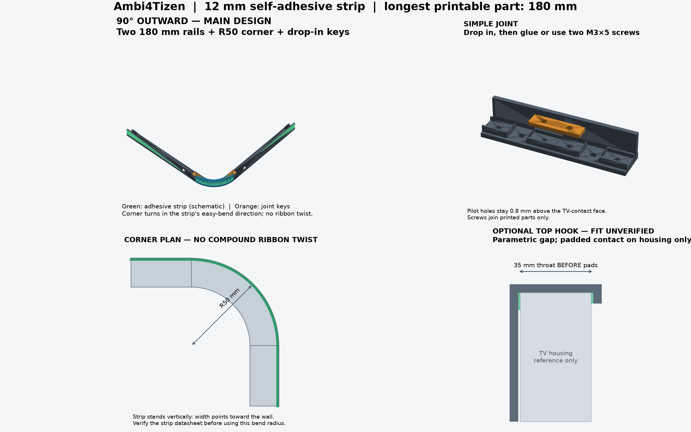
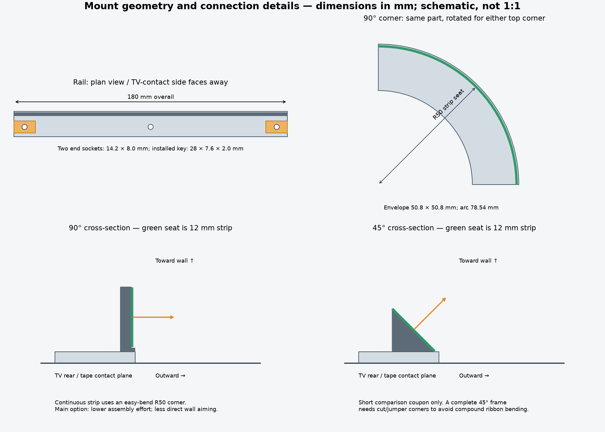

# Modular strip mounts — 12 mm self-adhesive strip

Dimensioned **prototype CAD**, supplied as printable STL and editable STEP.
Physical print fit, TV fit, adhesive performance, bend compatibility and load
capacity have not been tested. No TV settings or firmware are changed by these files.



## Decision: 90° outward with an R50 corner

Here, the angle describes the strip PCB plane relative to the TV rear plane.

| Option | Benefit | Assembly effort / limitation |
| --- | --- | --- |
| **90° upright, LEDs outward — main design** | A continuous strip can follow the cylindrical corner in its easy-bend direction, without twisting the ribbon | Simple rails and one repeatable corner; light is less directly aimed at the wall |
| **45° toward wall/outward — comparison coupon** | Aims the light partly toward the wall | A complete frame needs cut/jumper corners or a separately engineered loop; the upright R50 corner is not compatible |

The 90° design is selected for the simpler mechanical assembly and corner
routing. The real light pattern depends on LED optics, TV inset and wall gap.
Print the short 45° coupon as well if you want to compare the halo before
printing a full frame. This set does not claim a measured optical advantage.

## Print files and dimensions

All dimensions and STL import units are **millimetres**. Every individual part
fits within a 200 × 200 mm footprint; the longest default part is 180 mm, leaving
room for a modest brim. The large reference assembly is not a printable part.

| Part | Overall dimensions, mm | Purpose |
| --- | --- | --- |
| [180 mm rail](exports/rail_90_180.stl) | 180 × 16.8 × 16 | Main repeatable upright rail |
| [120 mm rail](exports/rail_90_120.stl) | 120 × 16.8 × 16 | Shorter runs |
| [60 mm rail](exports/rail_90_60.stl) | 60 × 16.8 × 16 | Shorter runs / light test |
| [40 mm fit coupon](exports/fit_coupon_90_40.stl) | 40 × 16.8 × 16 | Print two to check a joint first |
| [R50 corner](exports/corner_90_r50.stl) | 50.8 × 50.8 × 16 | One geometry, rotated for either top corner |
| [Standard key](exports/joint_key_standard.stl) | 28 × 7.6 × 2 | One per joint |
| [Looser key](exports/joint_key_loose.stl) | 28 × 7.4 × 2 | Alternative for printers with tighter fits |
| [45° comparison coupon](exports/sample_45_60.stl) | 60 × 16.8 × 11.451 | Optical comparison only; no compatible corner supplied |
| [Top hook — provisional](exports/top_hook_gap35_PROVISIONAL.stl) | 43 × 64 × 12 | Illustrative 35 mm internal throat; measure TV first |

A STEP file with the same basename accompanies each STL in [exports](exports).
The [reference assembly](exports/corner_assembly_REFERENCE_ONLY.step) shows two
rails, a corner and the installed joint keys. Use it for inspection, not slicing.
The [manifest](exports/manifest.json) records dimensions, solid volumes and checks.



The [SVG drawing](technical_drawing.svg) is a scalable explanatory drawing, not
an accurately scaled paper template.

## First print and basic settings

Start with **two 40 mm fit coupons, one standard key and one loose key**. Check
that the key drops in without forcing or splitting the socket. The key has
0.2 mm side clearance per side in the standard socket; printer tolerances vary.

PETG is the suggested starting material for its toughness and temperature
resistance in mechanical holders; follow the filament maker's profile. See
[Prusa's PETG guide](https://help.prusa3d.com/article/petg_2059).
Start with a 0.4 mm nozzle, 0.2 mm layers, four walls and approximately 20% infill.
Print the supplied files in their exported orientation: rails/corners on their
flat TV-contact base, keys flat, and the hook flat on its side profile. The
main rails/corner have no large unsupported roofs. Small horizontal nut pockets
in the hook may need local support or cleanup on your printer.

Do not scale the entire model to change strip width or fit. Change the source
parameters and regenerate, preserving the connector and screw dimensions.

## Rail, strip and connector assembly

The open strip seat is **12.8 mm wide**, with a lower 0.8 mm guide lip and no
closed lid. A 12 mm self-adhesive strip has roughly 0.4 mm margin at each edge.
The open face avoids a tight thickness-dependent snap fit. Keep LEDs facing
outward. Clean and prepare printed surfaces for the strip adhesive as its maker
specifies; remove print defects before attaching the PCB.

Butt adjoining modules together, then drop one key into their two top-access
sockets. A key is a locating insert, not a self-locking snap latch. Secure it
with a compatible adhesive **or two M3×5 screws**, one into each module.
The 2.6 mm pilot holes can be carefully chased with an M3 tap; printed threads
and PETG screw retention need a real fit check. Tighten lightly.

The screw length assumes the supplied 2 mm key seated at its socket floor.
An M3×5 tip stops **0.8 mm above the TV-contact face**. Longer screws can break
through. Inspect the underside after assembly. Screws join printed components;
**do not drill or drive screws into the TV housing**.

## Corners and the actual bend limit

The default corner has a **50 mm radius at the adhesive seat**, a 100 mm bend
diameter and a 78.54 mm quarter-circle path. The strip width runs toward the
wall, so the corner curves across strip thickness rather than sideways across
PCB width. Maintain the same strip plane through both module joints.

R50 is a provisional design choice, **not an approved limit for your future
strip**. Confirm its datasheet and construction before bending it. As one
manufacturer example, the [LEDYi strip handling manual](https://www.ledyilighting.com/wp-content/uploads/2024/06/LEDYi-LED-Strip-User-Manual.pdf)
calls for at least a 50 mm bend diameter and cautions against folding/distortion;
that specification does not establish the limit of an unidentified WS2812-type
strip. Increase the radius if your strip requires it. Keep components, soldered
joints and connectors free of concentrated bending or compression.

At 30 LEDs/m the nominal pitch is 33.33 mm; LED positions in the preview are
schematic. Measure your actual mounting path and cut only at the strip's marked
cut points. Rounded corners change path length. Do not assume the earlier
provisional 91-LED / 24–43–24 layout will fit this frame unchanged: count each
installed section and update the software mapping accordingly.

## Attachment option A: double-sided tape

The rail underside is flat. Use foam tape compatible with both PETG and the
particular TV housing/finish. Test a small hidden area and follow the tape's
application instructions. Suitability depends on the actual surface;
[3M's VHB guide](https://multimedia.3m.com/mws/media/2371577O/3m-vhb-tapes-product-information-guide.pdf)
also requires evaluating the tape for the application. Solvents or adhesion
primers are not automatically suitable for a TV finish.

Keep vents, labels, ports and service access clear. Foam can accommodate modest
surface irregularity; a long rigid rail will not match an arbitrary curved back.
Use shorter segments or measured spacers rather than forcing it against the case.
The PETG rail is a mechanical support, not a heat sink. Check the strip maker's
thermal requirements and real operating temperatures, particularly at full white.

## Attachment option B: top-edge hooks — measurement required

The included hook is **provisional**. Its internal throat is 35 mm before
padding, rear drop 60 mm and front return 5 mm. No measurement of the actual
TV top-edge profile or available bezel contact has been supplied. Do not assume
that the exported hook fits or that its front return can safely contact a screen.

Measure the housing cross-section and unobstructed wall gap. Set
`hook_clear_gap_mm` to the actual case thickness plus both protective pads and
clearance (for example, two 1 mm pads plus about 0.5 mm clearance). Contact must
be on suitable housing/bezel surfaces, **never the display glass/panel**. Pad the
top and both contact legs; do not clamp the TV or cover its vents.

The rear leg offers two alternative attachment heights. Align a rail's middle
3.4 mm through-hole with one hook hole. Use an M3 nut seated flush in the hook's
recess and an **M3×6** screw through the rail base; add compatible padding so
metal cannot touch the TV. Check that the chosen screw does not project beyond
the inner hook face. One bolt per hook is used; the second hole is a height
alternative. A suitable adhesive interface can help prevent rotation.

Two appropriately spaced hooks can support a trial frame, but no load rating
is claimed. Check a single light test module before adding the full assembly.
Use soft lower stand-offs if needed to prevent the frame rubbing the case.
Do not hang the ESP, power supply or other equipment from these hooks.

## Rebuild / customize

Source: [generate.py](generate.py), [parameters.json](parameters.json),
[render.py](render.py). Tested with Python 3.12 and the pinned packages below.
Run from the repository root:

```bash
python3 -m venv .local/cad-venv
.local/cad-venv/bin/pip install -r hardware/strip-mounts/requirements.txt
.local/cad-venv/bin/python hardware/strip-mounts/generate.py
.local/cad-venv/bin/python hardware/strip-mounts/render.py
```

Main customization fields are `strip_width_mm`, `rail_length_mm` (32–180 mm),
`corner_seat_radius_mm` and `hook_clear_gap_mm`. Treat the other dimensions as
coupled design values. A custom terminal length should be regenerated rather
than sawn off a socket end. Each generated part is rejected if an axis exceeds
200 mm. Recheck the drawing after changing parameters; previews are illustrative.

Validation performed: valid single-solid B-reps, watertight consistently wound
single-component STL meshes, maximum part extents, STEP reimport/volume checks,
and exact-solid interference checks for the two keys in the reference assembly.
These checks do not replace a test print, measured TV fit or bend verification.

The designs and source are provided under the project's [MIT license](../../LICENSE).
